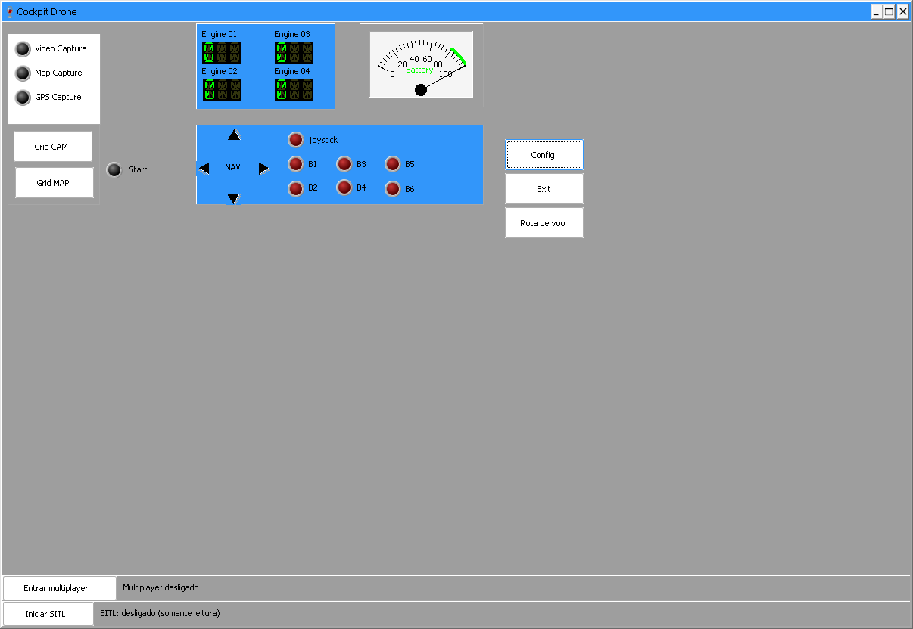
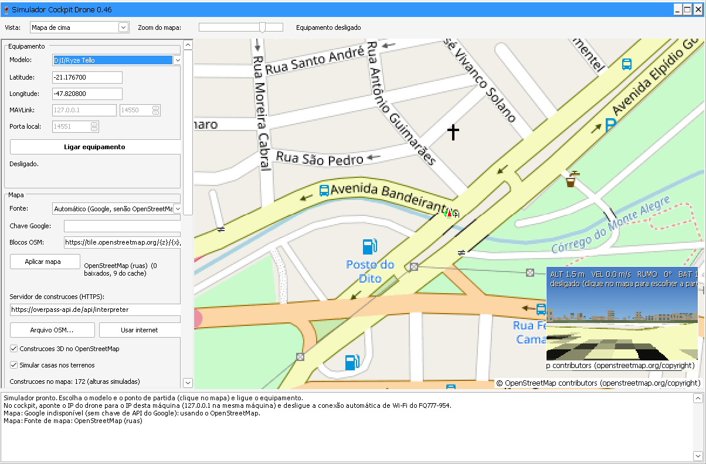

> **Versão 0.46:** casas/prédios na câmera com fallback a partir do mapa real, sinal infinito opcional, recuperação após queda e Xbox 360 configurável. Inclui WIFI_8K Legacy9/E58_8 experimentais e MSPv1/MSPv2/CRSF/SBUS/iBUS com 30 perfis de drone, helicóptero, avião, carro, barco e submarino. [Pilotagem](docs/CONTROLES_0.46.md) · [Protocolos e limites](docs/PROTOCOLOS_0.46.md) · [Simulador](simulador/docs/SIMULADOR_0.46.md) · [Dependências do instalador](docs/DEPENDENCIAS_0.46.md).

[Português](README.md) · [English](README.en.md) · [Español](README.es.md) · [Français](README.fr.md) · [Deutsch](README.de.md) · [Русский](README.ru.md) · [中文](README.zh-CN.md) · [日本語](README.ja.md) · [العربية](README.ar.md) · [हिन्दी](README.hi.md)

# Cockpit Drone - Sistema de Controle, Telemetria e Simulação

Aplicação completa desenvolvida em Object Pascal (Lazarus / Free Pascal) para controle remoto, monitoramento de telemetria e simulação física 3D de drones e aeronaves não tripuladas. Integra joystick analógico, sensores GPS, feed de vídeo ao vivo (H.264 e câmera sintética), mapas táticos (OpenStreetMap) e suporte a múltiplos protocolos de voo.

---

## Índice

1. [Visão Geral](#visão-geral)
2. [Estrutura do Projeto](#estrutura-do-projeto)
3. [Protocolos Suportados](#protocolos-suportados)
4. [Simulador 3D Oficial e Multiplayer](#simulador-3d-oficial-e-multiplayer)
5. [Controles: Joystick vs Teclado](#controles-joystick-vs-teclado)
6. [Instalação e Requisitos](#instalação-e-requisitos)
7. [Planejamento de Rota de Voo](#planejamento-de-rota-de-voo)
8. [Download dos Binários Compilados](#download-dos-binários-compilados)
9. [Contato e Licença](#contato-e-licença)

---

## Manuais e documentação ilustrada

- **[Manual ilustrado de treinamento para profissionais do SUS — versão 0.46](docs/GUIA_SUS_0.46.md)** — objetivos, primeiro voo simulado, controles Xbox 360, protocolos, mundo compartilhado e **capturas reais do Cockpit e do Simulador**.
- **[Treinamento de inspeção de quintais (Aedes aegypti)](simulador/docs/QUINTAIS_AEDES.md)** — casas em proporção real com lote e quintal; vasos, piscinas, caixas d'água, pneus, tanques de peixe e baldes em versão segura e com água parada; câmera de inspeção e gabarito para o instrutor (código de 09/11/2026, requer recompilar o simulador).
- **[Guia ilustrado das telas — versão 0.46](docs/TELAS_0.46.md)** — 17 capturas reais do Cockpit e do Simulador: janela principal, todas as abas de configuração, rota de voo e as vistas do simulador.
- [Guia de pilotagem e joystick](docs/CONTROLES_0.46.md) · [Protocolos e limitações](docs/PROTOCOLOS_0.46.md) · [Simulador e cenário urbano](simulador/docs/SIMULADOR_0.46.md) · [Dependências de instalação](docs/DEPENDENCIAS_0.46.md).

  
  

<em>Cockpit (à esquerda) e Simulador (à direita) da versão 0.46 — capturas de tela reais dos executáveis do repositório.</em>

---

## Finalidade: capacitação e apoio à vigilância em saúde no SUS

O **Cockpit Drone** é um projeto de código aberto para **treinamento de pilotagem no simulador** e **operação/monitoramento de drones compatíveis por notebook**. Uma aplicação proposta é apoiar equipes municipais do **Sistema Único de Saúde (SUS)**, especialmente a **Vigilância Ambiental em Saúde** e os profissionais envolvidos na prevenção e controle das arboviroses transmitidas pelo *Aedes aegypti*.

O fluxo pretendido é **aprender no ambiente virtual antes de utilizar o equipamento físico**: familiarizar-se com os comandos, praticar decolagem, deslocamento, aproximação, observação e retorno, e depois conectar um drone compatível para inspeções em campo. Isso reduz a exposição de equipamentos a erros de iniciantes, mas **o simulador não substitui treinamento prático supervisionado, avaliação operacional ou as regras aplicáveis ao voo**.

### O que o monitoramento pode e não pode demonstrar

Imagens aéreas podem ajudar a **localizar situações suspeitas de acúmulo de água**, por exemplo em caixas-d'água destampadas, calhas, lajes e recipientes visíveis. **Uma imagem não comprova a presença de ovos, larvas ou mosquitos**. A identificação e o encaminhamento de possíveis criadouros dependem dos procedimentos e da avaliação da equipe de vigilância. O uso do drone não substitui visita, inspeção ou intervenção quando necessárias.

As operações reais devem observar as exigências brasileiras aplicáveis (ANAC, DECEA e ANATEL, conforme o caso), planejamento de risco, privacidade e proteção de dados. **Não se deve sobrevoar ou filmar residências e pessoas sem a base legal e as autorizações pertinentes**. A adequação ao serviço público de saúde depende de avaliação institucional; o projeto não representa uma solução oficialmente homologada ou adotada pelo SUS.

### Dois ambientes complementares

1. **Simulador 3D:** treinamento sem risco de danificar uma aeronave real, com perfis de veículos, vento, bateria, GPS, falhas simuladas, recuperação após queda, cenário urbano e câmera sintética. A documentação da versão 0.46 informa que **as construções ainda não têm colisão física**, portanto o treinamento não reproduz integralmente acidentes com obstáculos.
2. **Cockpit de operação:** interface para configurar protocolos disponíveis, joystick/teclado, telemetria, vídeo e mapas, conectando equipamentos compatíveis conforme suas capacidades efetivas. A existência de um adaptador de protocolo **não garante compatibilidade com todos os drones da marca nem validação em voo físico**.

### Protocolos disponibilizados — não confundir com homologação

A tabela abaixo descreve **adaptadores de comunicação presentes no projeto**, e não uma lista de drones homologados, certificados ou ensaiados individualmente.

| Equipamento ou família | Interface/protocolo disponibilizado | Observações |
| --- | --- | --- |
| Cheerson CX-10W | Wi-Fi; adaptador CX-10W | Controle de aceleração direta; não possui decolagem/pouso automáticos por A/B no perfil documentado. |
| DJI/Ryze Tello | SDK Tello por Wi-Fi | Comandos de decolagem/pouso e velocidade vertical conforme adaptador. |
| MAVLink (ArduPilot/PX4) | MAVLink | Recursos variam conforme firmware, configuração e modo de voo. |
| Parrot AR.Drone 2.0 | Comandos AT/telemetria/vídeo | Adaptador específico do modelo. |
| FQ777-954 | Wi-Fi; adaptador FQ777 | Controle proporcional; exige verificação no equipamento real. |
| ESP-Drone / OpenDrone | CRTP | Depende do firmware/interface compatível. |
| Drone ESP32 (CDP) | Protocolo CDP | Requer firmware correspondente. |
| WIFI_8K | Legacy9 e E58_8 | **Experimental:** candidatos de protocolo, sem compatibilidade física confirmada para cada drone. |
| RC genérico | MSPv1, MSPv2, CRSF, SBUS e iBUS | Saídas de canais e perfis configuráveis; exigem interface elétrica, receptor/controladora e firmware adequados. Não equivalem a um rádio transmissor completo. |

Há perfis RC para **drone, helicóptero, avião, carro, barco e submarino**. A documentação distingue o que foi validado em software do que **não foi ensaiado com hardware real**. Consulte [protocolos e limitações](docs/PROTOCOLOS_0.46.md), [comandos de pilotagem](docs/CONTROLES_0.46.md) e [WIFI_8K experimental](docs/WIFI_8K_EXPERIMENTAL.md).

### Simulador, câmera e cenário

O simulador independente pode ser utilizado com o Cockpit em **Modo simulador**, sem conectar um drone físico. A versão 0.46 documenta cenários a partir de **OpenStreetMap**, edificações registradas no mapa e **casas/prédios fictícios** gerados em áreas residenciais. Esses elementos **não representam necessariamente a geometria ou as condições reais de um imóvel**. A câmera sintética compartilhada com o cockpit é documentada em **640 × 360 pixels, até 10 quadros por segundo**. Há opção de **sinal infinito para treinamento**; desligá-la permite praticar os limites de alcance simulados dos modelos.

Para começar: abra o simulador, escolha o modelo, inicie a simulação e, no Cockpit, selecione o **mesmo equipamento** com **Modo simulador** ativado. Configure e teste os eixos do controle **antes de iniciar**. Os procedimentos variam por modelo; siga o [guia do simulador](simulador/docs/SIMULADOR_0.46.md) e o [guia de controles](docs/CONTROLES_0.46.md). **Os comandos de um modelo não devem ser ensinados como se fossem universais**.

### Site e interação entre participantes

O repositório inclui um componente de servidor **PHP/WebSocket** para **mundo compartilhado/multiplayer**. No simulador, a opção **Mundo compartilhado** permite informar o endereço do servidor e um apelido; a documentação descreve visualização de outras aeronaves em um raio de até **2 km**. Isso pode apoiar atividades coletivas e demonstrações, sujeito à disponibilidade e à configuração do servidor.

- **Endereço indicado no projeto para mundo compartilhado:** https://maurinsoft.com.br/cockpit/ — endereço documentado, **sem garantia de disponibilidade em tempo real**.
- **Página do projeto:** https://maurinsoft.com.br/wp/projetos-open-source/projeto-cockpit-drone/
- **Código-fonte e documentação:** https://github.com/marcelomaurin/cockpit_drone

**Importante:** o multiplayer descrito é um recurso de **simulação compartilhada**; não deve ser interpretado como autorização para controle remoto de aeronaves reais por terceiros.

### Proposta de uso em capacitações

Uma sequência didática possível para equipes de vigilância é: **(1)** reconhecer comandos e limitações do modelo; **(2)** treinar no simulador, incluindo falhas e procedimentos de segurança; **(3)** praticar observação de situações suspeitas em cenários fictícios; **(4)** avaliar o desempenho do aluno; **(5)** realizar treinamento supervisionado com equipamento real, quando autorizado; **(6)** registrar e encaminhar observações pelos fluxos institucionais. **Esta sequência é uma proposta pedagógica, não uma funcionalidade integralmente automatizada nem um protocolo oficial do SUS.**

---

## Visão Geral

O **Cockpit Drone** foi projetado com arquitetura de thread dedicada desacoplada da interface do usuário (UI), garantindo que os laços críticos de envio de comandos de voo (50 ms) e recepção de telemetria nunca sejam interrompidos por travamentos ou caixas de diálogo na interface.

Principais recursos:
- **Laço de Voo Seguro:** Thread independente de comunicação com corte de pânico na barra de espaço e retorno suave ao ponto de sustentação (*hover*).
- **Interface Tática Multijanela:** Instrumentos de voo, painel de status por LEDs, HUD militar tático, mapa geoespacial interativo e feed de vídeo em tempo real.
- **Ecossistema Completo:** Inclui o **Simulador 3D** (`simulador/simulador.exe`) com física 6DOF e o servidor web multiplayer em PHP/WebSocket (`PHP/`).

---

## Estrutura do Projeto

- **`src/main.pas`:** Interface gráfica principal do sistema. Gerencia os controles visuais, status por LEDs, processamento de atalhos e acionamento dos módulos.
- **`src/config.pas`:** Painel de configuração com seleção de protocolos, ajuste de joystick com calibração visual em tempo real, mapeamento de teclas e seletor de idiomas.
- **`src/joystick.pas`:** Módulo de gerenciamento de controles analógicos físicos (DirectInput / SDL), com suporte a manches de voo, gamepads e filtros de zona morta.
- **`src/gps.pas`:** Leitura contínua de portas seriais e decodificação de sentenças NMEA, com exibição de satélites e qualidade de sinal.
- **`src/camera.pas`:** Decodificação de vídeo H.264 via FFmpeg e captura em memória compartilhada da câmera sintética do simulador 3D (`cockpit_sim_camera.bmp`).
- **`src/map.pas`:** Mapeamento geoespacial interativo baseado em OpenStreetMap (MapViewer), com rastro de trajetória em tempo real, waypoints e geocerca.
- **`simulador/`:** Projeto autônomo do simulador de voo 3D (`simulador.lpi`), emulando dinâmica de voo, sensores e câmera para testes locais ou mundo compartilhado.
- **`PHP/`:** Servidor HTTP/WebSocket de simulação compartilhada para sincronização de drones no mapa em um raio de até 2 km.

---

## Protocolos Suportados

Os protocolos de comunicação integram a [Lazarus AI Suite (CHATGPT)](https://github.com/marcelomaurin/CHATGPT) no pacote `openai_drone`, compartilhando a arquitetura base de `conexaodrone.pas`:

| Drone / Protocolo | Componente | Descrição / Canal |
|---|---|---|
| **Cheerson CX-10W** | `TAIDroneCX10W` | Wi-Fi UDP 8895 / TCP 8888, comandos a 50 ms e vídeo H.264 |
| **MAVLink (ArduPilot/PX4)** | `TAIDroneMavlink` | UDP 14550, telemetria completa, missões e waypoints |
| **DJI / Ryze Tello** | `TAIDroneTello` | Wi-Fi UDP comandos/telemetria e vídeo H.264 |
| **ESP-Drone / OpenDrone** | `TAIDroneESPDrone` | Protocolo CRTP via UDP 2390 para firmware Espressif |
| **FQ777-954** | `TAIDroneFQ777` | Conexão Wi-Fi automática, controle proporcional e vídeo |
| **Parrot AR.Drone 2.0** | `TAIDroneARDrone` | Comandos AT (UDP 5556), telemetria (UDP 5554) e vídeo TCP 5555 |
| **Drone ESP32 (Cockpit)** | `TAIDroneCDP` | Firmware aberto dedicado CDP com ESP32 + MPU6050 |

---

## Simulador 3D Oficial e Multiplayer

O projeto conta com o **Simulador Cockpit Drone** (`simulador/simulador.exe`), um executável independente que emula os drones reais sobre imagens de satélite ou OpenStreetMap.

> **IMPORTANTE — ENTRADA MULTIPLAYER:**  
> A entrada no **Multiplayer (Mundo Compartilhado)** é feita através do **Simulador** (`simulador.exe`):  
> 
> 1. Abra o `simulador.exe`.  
> 2. No painel **Mundo compartilhado**, informe o endereço do servidor (oficial: `https://maurinsoft.com.br/cockpit/`) e seu **Apelido**, e clique em **Entrar**.  
> 3. Drones voando em um raio de até **2 km** aparecem no mapa e na câmera 3D.  
> 4. O **Cockpit Drone** (`drone.exe`) conecta-se localmente em `127.0.0.1`, permitindo pilotar, monitorar telemetria e ver os instrumentos.

---

## Controles: Joystick vs Teclado

- **Joystick Analógico (Recomendado):** Proporciona modulação contínua e suave dos 4 eixos (arfagem, rolagem, guinada e aceleração). Compatível com manches de voo, gamepads (Xbox, PlayStation) e rádios RC via USB.
- **Teclado:** Permite pilotagem completa com atalhos direcionais, retorno suave ao pairar e **corte imediato de emergência** na barra de espaço.

### Mapa Principal de Teclas

| Comando | Tecla Principal | Tecla Alternativa | Ação |
|---|---|---|---|
| **Frente (Pitch +)** | `W` | `Seta Acima` | Inclina para frente |
| **Trás (Pitch -)** | `S` | `Seta Abaixo` | Inclina para trás |
| **Esquerda (Roll -)** | `A` | `Seta Esquerda` | Inclina para a esquerda |
| **Direita (Roll +)** | `D` | `Seta Direita` | Inclina para a direita |
| **Subir (Throttle +)** | `E` | `Page Up` | Aumenta altitude/potência |
| **Descer (Throttle -)** | `Q` | `Page Down` | Reduz altitude/potência |
| **Girar Esquerda (Yaw -)** | `1` ou `Z` | Botão 1 | Giro no próprio eixo anti-horário |
| **Girar Direita (Yaw +)** | `2` ou `X` | Botão 2 | Giro no próprio eixo horário |
| **Decolar / Armar** | `3` ou `Insert` | Botão 3 | Arma motores ou decola |
| **Pousar / Desarmar** | `4` ou `Delete` | Botão 4 | Pouso automático ou desarma |
| **Pairar / Centralizar** | `5` ou `R` / `Home` | Botão 5 | Estabiliza e centraliza |
| **PÂNICO / CORTE** | `Espaço` | Botão Emergência | Zera motores imediatamente |
| **HUD Tático** | `T` | — | Alterna visualização do HUD |
| **Janela Câmera** | `C` | — | Alterna feed de vídeo |
| **Janela Mapa** | `M` | — | Alterna mapa de navegação |
| **Janela GPS** | `G` | — | Alterna telemetria GPS |

---

## Instalação e Requisitos

1. Instale o **Lazarus IDE** e o **Free Pascal**.
2. Instale os componentes da [Lazarus AI Suite (CHATGPT)](https://github.com/marcelomaurin/CHATGPT).
3. Abra `src/drone.lpi` no Lazarus e compile o projeto.
4. Para a decodificação de vídeo da câmera, copie o executável `ffmpeg.exe` para a mesma pasta do `drone.exe` ou garanta sua presença no PATH do sistema.

---

## Planejamento de Rota de Voo

Para drones com piloto automático e GPS (como MAVLink / ArduPilot / PX4):
1. Acesse o botão **Rota de voo** no menu principal.
2. Adicione pontos clicando diretamente sobre o mapa OpenStreetMap (ou importe arquivos `.waypoints` compatíveis com Mission Planner / QGroundControl).
3. Configure altitude, velocidade, raio de geocerca e ação ao final da missão (retornar ao início, pousar ou pairar).
4. Clique em **Enviar ao drone** e confirme para iniciar a missão autônoma.

---

## Download dos Binários Compilados

Os executáveis pré-compilados e o instalador oficial completo para Windows estão disponíveis diretamente na pasta [`bin/`](bin/):
- **`bin/setup_cockpit_drone_0.41.exe`:** Instalador completo para Windows com Cockpit, Simulador e bibliotecas.
- **`bin/drone.exe`:** Executável do Cockpit Drone.
- **`bin/simulador.exe`:** Executável do Simulador 3D.

---

## Contato e Licença

- **Autor:** Marcelo Maurin Martins
- **E-mail:** marcelomaurinmartins@gmail.com
- **WhatsApp:** +55 16 98143-4112
- **Site Oficial:** [Maurinsoft - Cockpit Drone](https://maurinsoft.com.br/wp/projetos-open-source/projeto-cockpit-drone/)
- **Licença:** Código aberto sob licença livre permissiva.
