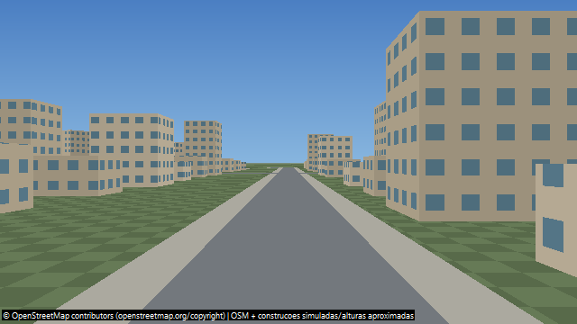
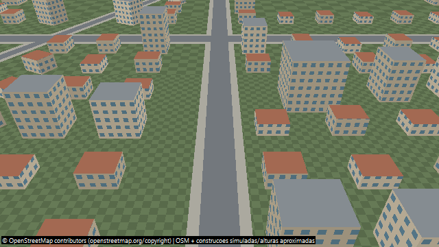
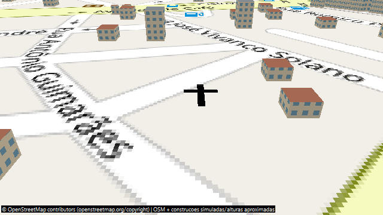

# Cockpit Drone 0.46 — Manual de uso e treinamento para o SUS

**Público:** profissionais de Vigilância Ambiental em Saúde, agentes de combate às endemias e instrutores. **Escopo:** funcionalidades documentadas na versão 0.46. Este guia não é protocolo oficial do SUS nem certificação de voo.

## Objetivo

O Cockpit Drone permite **treinar pilotagem no simulador 3D** e utilizar um cockpit de operação com instrumentos, mapas, câmera e adaptadores de comunicação para equipamentos compatíveis. Na vigilância ambiental, a observação aérea pode ajudar a identificar **situações suspeitas** de água acumulada em caixas-d'água abertas, calhas e recipientes visíveis. Uma imagem **não confirma a presença de larvas ou um foco de dengue**. A inspeção e o encaminhamento seguem os procedimentos da equipe responsável.

## Componentes

| Componente | Uso |
| --- | --- |
| `drone.exe` | Cockpit: controles, instrumentos, mapa, câmera e seleção de equipamento |
| `simulador.exe` | Treinamento 3D: modelos, vento, bateria, alcance e falhas simuladas |
| `PHP/` | Servidor de mundo compartilhado em PHP/WebSocket |
| Adaptadores de protocolo | Comunicação com famílias específicas de equipamentos |

## Conheça o cenário e a câmera do simulador

As imagens abaixo são **capturas existentes no próprio repositório**, geradas pelo simulador; não são fotografias de drones reais nem capturas inventadas.

*Figura 1 — Exemplo de câmera sintética exportada pelo simulador.*

*Figura 2 — Segundo exemplo de câmera sintética para treinamento.*

*Figura 3 — Saída da câmera gerada a partir de blocos OSM reais em cache, com construções fictícias adicionadas pelo simulador. Não representa uma inspeção aérea real.*

O simulador usa OpenStreetMap e pode combinar edifícios cadastrados com **casas e prédios fictícios**. A câmera compartilhada com o Cockpit é de **640 × 360 pixels, até 10 quadros por segundo**. A versão 0.46 **não possui colisão física com os prédios**. Veja [documentação do simulador](../simulador/docs/SIMULADOR_0.46.md).

## Primeiro exercício: Cheerson CX-10W com controle Xbox 360

1. Abra o **Simulador Cockpit Drone**, selecione **Cheerson CX-10W** e inicie a simulação.
2. No Cockpit, acesse **Configuração → Tipo de equipamento**, escolha **Cheerson / CX-10W** e marque **Modo simulador**. A comunicação ocorre em `127.0.0.1`, TCP 8888 e UDP 8895, sem conectar à rede Wi-Fi de um drone físico.
3. Em **Joystick**, selecione **Controle 1** e habilite o controle. Em **Controle de voo**, escolha **Automático** ou **Modo 2** e clique em **Salvar e testar perfil**, com **Start desligado**.
4. Verifique os quatro eixos. Feche a configuração, leve o manche esquerdo **até o mínimo** e ligue **Start**. Aguarde a conexão e mantenha o mínimo brevemente para liberar a trava.
5. Suba o manche esquerdo **gradualmente**. Para pousar, reduza a aceleração aos poucos e, após tocar o chão, leve-a ao mínimo. Desligue **Start** ao terminar.

### Mapeamento Xbox 360 — Modo 2

| Movimento | Comando |
| --- | --- |
| Aceleração | Manche esquerdo, vertical |
| Guinada, giro | Manche esquerdo, horizontal |
| Arfagem, frente/trás | Manche direito, vertical |
| Rolagem, deslocamento lateral | Manche direito, horizontal |

**Importante:** no Cheerson, o manche esquerdo controla **potência direta**; a posição central do Xbox equivale a cerca de 50% de aceleração, não a pairar automaticamente. Os botões **A e B não executam decolagem/pouso automáticos** nesse modelo. Outros protocolos podem usar funções diferentes. Consulte [controles da versão 0.46](CONTROLES_0.46.md).

## Praticar cenário urbano, alcance e recuperação

Em **Mapa**, selecione **OpenStreetMap (ruas)**, ative **Construções 3D no OpenStreetMap** e **Simular casas nos terrenos**, depois clique **Aplicar mapa**. Para treinar sem perda simulada de rádio, marque **Simulação → Sinal infinito (treinamento)**. Com a opção desativada, o Cheerson e o FQ777 têm alcance simulado de **30 metros**, incluindo a altura. Após uma queda, aguarde cerca de **1,5 segundo**; no Cheerson, retorne o acelerador ao mínimo antes de tentar novamente.

## Interação pelo site: mundo compartilhado

No `simulador.exe`, abra **Mundo compartilhado**, informe **https://maurinsoft.com.br/cockpit/** e um **apelido**, e clique **Entrar**. A documentação informa visualização de outros participantes em um raio de até **2 km**. O Cockpit continua conectado ao simulador local. **O multiplayer é de simulação**, não autoriza comandar drones físicos de terceiros. A disponibilidade do site não foi verificada em tempo real.

## Protocolos disponíveis — não homologados

| Família | Interface | Observação |
| --- | --- | --- |
| Cheerson CX-10W | Wi-Fi, adaptador CX-10W | Aceleração direta |
| Ryze Tello | SDK Tello | A/B para decolar/pousar no perfil documentado |
| MAVLink (ArduPilot/PX4) | MAVLink | Depende de firmware e configuração |
| Parrot AR.Drone 2.0 | Comandos AT | Adaptador específico |
| FQ777-954 | Wi-Fi | Controle proporcional |
| ESP-Drone / OpenDrone | CRTP | Depende do firmware |
| Drone ESP32 (CDP) | CDP | Requer firmware correspondente |
| WIFI_8K | Legacy9 / E58_8 | **Experimental; compatibilidade física não confirmada** |
| RC genérico | MSPv1/v2, CRSF, SBUS, iBUS | Saídas de canais; exigem interface e controladora compatíveis |

Há **30 perfis RC** distribuídos entre drone, helicóptero, avião, carro, barco e submarino. A existência do adaptador **não comprova homologação ou ensaio de voo real**. Consulte [protocolos e limitações](PROTOCOLOS_0.46.md) e [WIFI_8K experimental](WIFI_8K_EXPERIMENTAL.md).

## Cuidados para aplicação na vigilância

Treine primeiro no simulador; confira controles e resposta do equipamento antes de qualquer voo real; siga as regras aplicáveis da **ANAC, DECEA e ANATEL** e as políticas institucionais de segurança, privacidade e proteção de dados. Não trate imagens aéreas como diagnóstico entomológico. O uso de drones não substitui a visita técnica ou o trabalho dos agentes quando necessários.

## Instalação, documentação e código

O README principal indica executáveis na pasta [`bin/`](../bin/) e compilação pelo **Lazarus/Free Pascal**, com componentes da [Lazarus AI Suite](https://github.com/marcelomaurin/CHATGPT). A versão do instalador disponibilizado pode ser diferente da versão da documentação. Consulte [dependências do instalador](DEPENDENCIAS_0.46.md), [README principal](../README.md) e a [página do projeto](https://maurinsoft.com.br/wp/projetos-open-source/projeto-cockpit-drone/).

**Autor:** Marcelo Maurin Martins. **Documentação baseada no estado descrito do Cockpit Drone 0.46; nenhuma funcionalidade foi adicionada por este manual.**
