# Cockpit Drone 0.46 — guia ilustrado das telas

Este guia mostra as janelas reais do **Cockpit** (`drone.exe`) e do **Simulador** (`simulador.exe`) da versão 0.46, com o que cada uma faz. Para os passos de pilotagem, consulte [controles 0.46](CONTROLES_0.46.md); para o treinamento no SUS, o [manual ilustrado](GUIA_SUS_0.46.md).

> **Como as imagens foram obtidas.** Todas as figuras são capturas de tela dos executáveis do repositório em funcionamento, sem montagem nem edição além do recorte da janela. Os arquivos executados têm o mesmo SHA-256 registrado em [`runtime-manifest-0.46.json`](../runtime-manifest-0.46.json) (`drone.exe` `c6c20f59…3cea`; `simulador.exe` `f7d12a47…a9`). A execução foi feita em 09/11/2026 no Wine 9.0 sobre Linux, numa área de trabalho Windows virtual de 1600 × 1000; por isso a moldura das janelas e as fontes podem diferir ligeiramente do Windows nativo. Os blocos de mapa vieram do cache OSM incluído no repositório (`tests/fixtures/osm_tiles17`), pois o ambiente de captura não tinha acesso à internet.

## 1. Janela principal do Cockpit

*Figura 1 — Janela principal do Cockpit, logo após abrir.*

| Área | Função |
| --- | --- |
| **Video Capture / Map Capture / GPS Capture** | Clicar no indicador mostra ou oculta a janela da câmera, do mapa ou do GPS; o indicador acende quando a janela está aberta. |
| **Grid CAM / Grid MAP** | Liga ou desliga a grade de referência sobre a câmera e sobre o mapa. |
| **Start** | Liga e desliga a conexão com o equipamento escolhido em Configuração. |
| **Engine 01 a 04** | Mostradores dos quatro motores. |
| **Battery** | Medidor analógico da bateria informada pelo equipamento. |
| **NAV / Joystick / B1 a B6** | Painel de teste dos comandos: setas de navegação, estado do joystick e seis botões. |
| **Config / Exit / Rota de voo** | Configuração, saída e planejador de rota. |
| **Entrar multiplayer** | Entra no mundo compartilhado; o estado aparece ao lado. |
| **Iniciar SITL** | Liga a telemetria do ArduPilot SITL (somente leitura). |

## 2. Configuração

O botão **Config** abre a janela de configuração. As abas exibidas mudam conforme o protocolo: com Cheerson aparece a aba **Cheerson CX-10W**; com MAVLink, a aba **MAVLink**; com Tello, a aba **DJI Tello**.

### 2.1 Tipo de equipamento

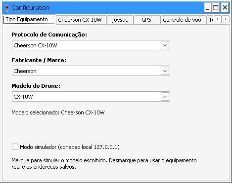

*Figura 2 — Escolha de protocolo, fabricante e modelo. O padrão é o Cheerson CX-10W.*

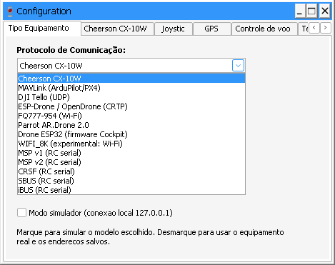

*Figura 3 — Os 13 protocolos de comunicação disponíveis na 0.46: Cheerson CX-10W, MAVLink, DJI Tello, ESP-Drone/OpenDrone, FQ777-954, Parrot AR.Drone 2.0, Drone ESP32, WIFI_8K (experimental) e os cinco formatos de rádio serial MSP v1, MSP v2, CRSF, SBUS e iBUS. Ter o adaptador não significa homologação; veja [protocolos e limites](PROTOCOLOS_0.46.md).*

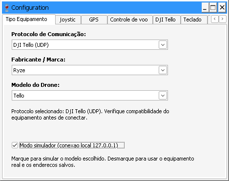

*Figura 4 — **Modo simulador** marcado: o Cockpit passa a falar com o simulador em 127.0.0.1, mantendo salvos os endereços do equipamento real. A troca só é aceita com **Start desligado**; com Start ligado o Cockpit exibe o aviso "Desligue Start antes de trocar entre simulador e equipamento real".*

### 2.2 Endereços do equipamento

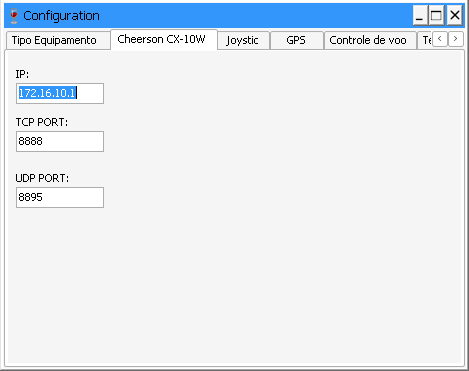

*Figura 5 — Aba do Cheerson CX-10W: IP 172.16.10.1, porta TCP 8888 e porta UDP 8895.*

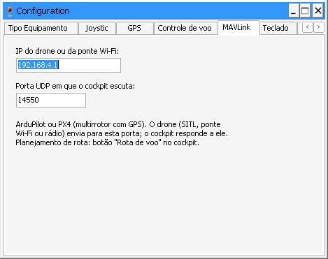

*Figura 6 — Aba MAVLink: IP do drone ou da ponte Wi-Fi e porta UDP em que o Cockpit escuta (padrão 14550). Ao escolher MAVLink, o fabricante passa a "Custom" e o modelo a "ArduPilot Copter".*

### 2.3 Joystick e Controle de voo

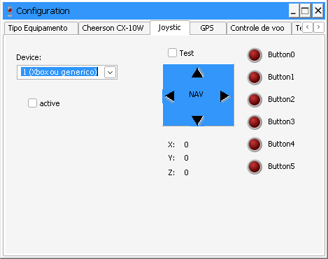

*Figura 7 — Aba Joystick: escolha do controle, ativação, teste e leitura dos eixos X, Y, Z e dos botões 0 a 5.*

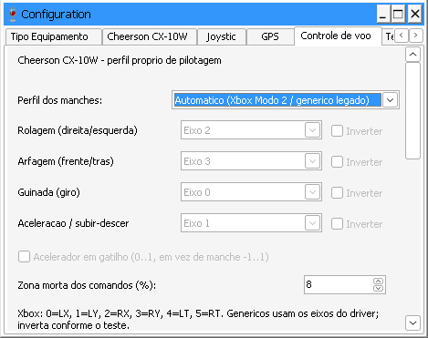

*Figura 8 — Aba Controle de voo: perfil dos manches (Automático = Xbox Modo 2 ou genérico legado), associação dos eixos de rolagem, arfagem, guinada e aceleração, inversão, acelerador no gatilho e zona morta (padrão 8%). O perfil é salvo por marca e modelo.*

### 2.4 GPS, Teclado e Idioma

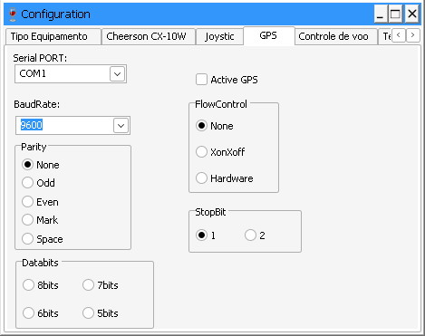

*Figura 9 — Aba GPS: porta serial, velocidade, paridade, bits de dados, bits de parada e controle de fluxo do receptor GPS.*

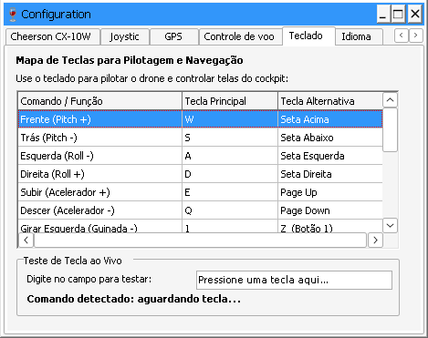

*Figura 10 — Aba Teclado: mapa de teclas para pilotar sem joystick (W/S frente e trás, A/D lados, E/Q subir e descer, 1/Z girar…) e campo para testar a tecla ao vivo.*

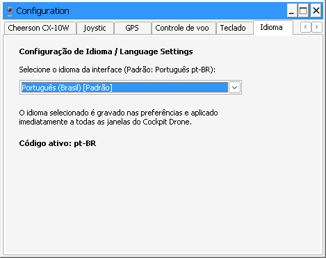

*Figura 11 — Aba Idioma: o padrão é Português (Brasil); a escolha vale imediatamente para todas as janelas. Os idiomas disponíveis estão em [LANGUAGES.md](LANGUAGES.md).*

## 3. Rota de voo

O planejamento de rota só existe para drones com GPS. Com um equipamento sem GPS, o Cockpit avisa e indica o caminho:

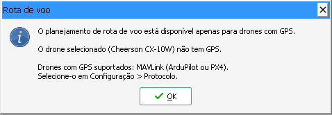

*Figura 12 — Aviso exibido com o Cheerson CX-10W selecionado.*

Com **MAVLink (ArduPilot/PX4)** selecionado, abre o planejador:

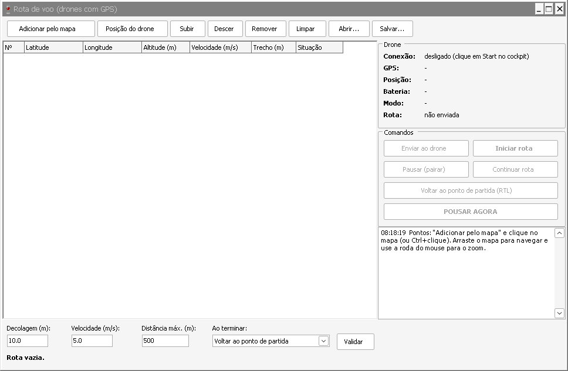

*Figura 13 — Planejador de rota: inclusão de pontos pelo mapa ou pela posição do drone, reordenação, abrir e salvar rota; altitude de decolagem (10 m), velocidade (5 m/s), distância máxima (500 m) e ação ao terminar (voltar ao ponto de partida). Os comandos Enviar, Iniciar, Pausar, Continuar, RTL e Pousar ficam desativados até haver conexão e rota válida.*

O planejador abre junto a janela **Mapa**, onde os pontos são marcados. Ela não foi ilustrada aqui porque depende de blocos baixados da internet, indisponíveis no ambiente de captura.

## 4. Simulador

*Figura 14 — Simulador 0.46 na vista **Mapa de cima**, no ponto padrão (-21,1767; -47,8208), com mapa OpenStreetMap e 172 construções (cadastradas e simuladas). À esquerda: equipamento, posição, endereços e opções de mapa; no canto, a miniatura da câmera; embaixo, o registro de eventos.*

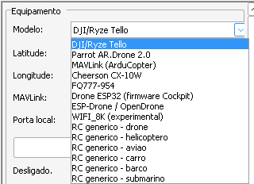

*Figura 15 — Os 14 modelos do simulador: Tello, AR.Drone 2.0, MAVLink (ArduCopter), Cheerson CX-10W, FQ777-954, Drone ESP32, ESP-Drone, WIFI_8K e seis categorias de rádio genérico (drone, helicóptero, avião, carro, barco e submarino).*

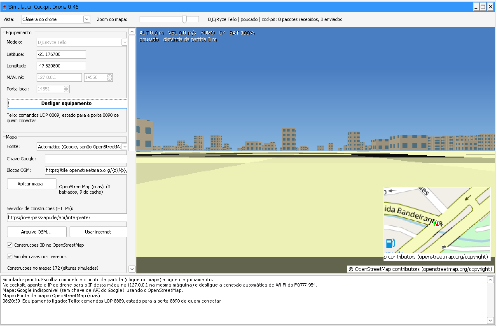

*Figura 16 — Vista **Câmera do drone** logo após **Ligar equipamento**, com o drone pousado. A barra superior informa altitude, velocidade, rumo e bateria; a linha do topo mostra modelo, estado e pacotes trocados com o Cockpit; o mapa passa para a miniatura.*

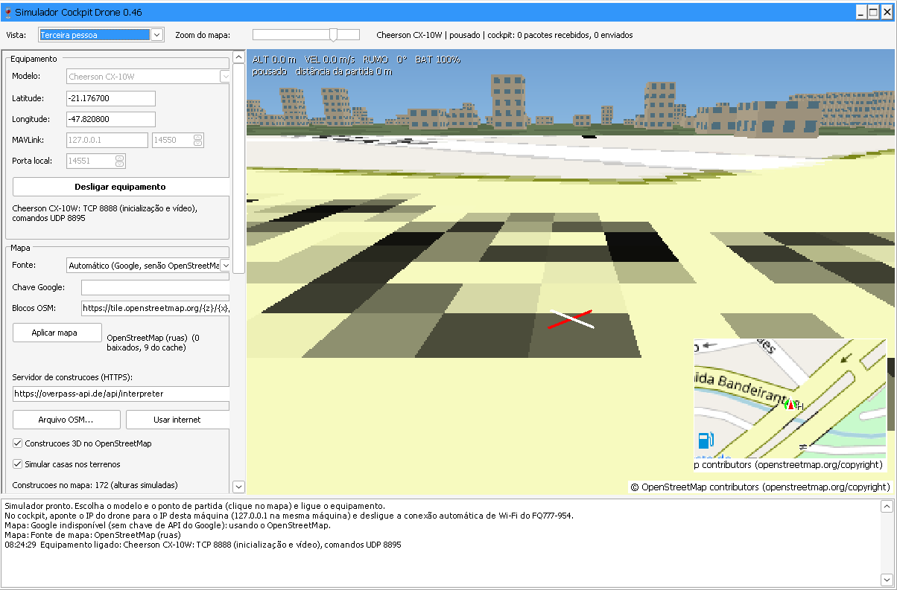

*Figura 17 — Vista **Terceira pessoa**, com o Cheerson CX-10W ligado. As construções são desenhadas em 3D, mas na 0.46 ainda não têm colisão física.*

As vistas disponíveis são **Câmera do drone**, **Terceira pessoa** e **Mapa de cima**. A imagem enviada ao Cockpit é sempre a da câmera do drone, qualquer que seja a vista escolhida no simulador. Detalhes de cenário, sinal infinito e recuperação estão em [simulador 0.46](../simulador/docs/SIMULADOR_0.46.md).

## 5. Limites desta documentação

- As telas foram capturadas no Wine; a aparência no Windows pode variar com o tema e a escala do sistema.
- A conexão do Cockpit com o simulador **não** foi ilustrada: no ambiente de captura o simulador registrou 0 pacotes recebidos do Cockpit, e não foi possível distinguir se isso se deve ao Wine. O procedimento validado está em [controles 0.46](CONTROLES_0.46.md).
- Janelas que dependem de vídeo, joystick físico, GPS serial ou internet (câmera ao vivo, mapa do Cockpit, mundo compartilhado) não aparecem neste guia.
