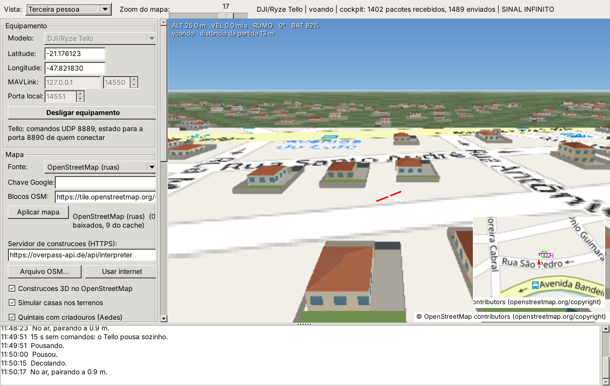
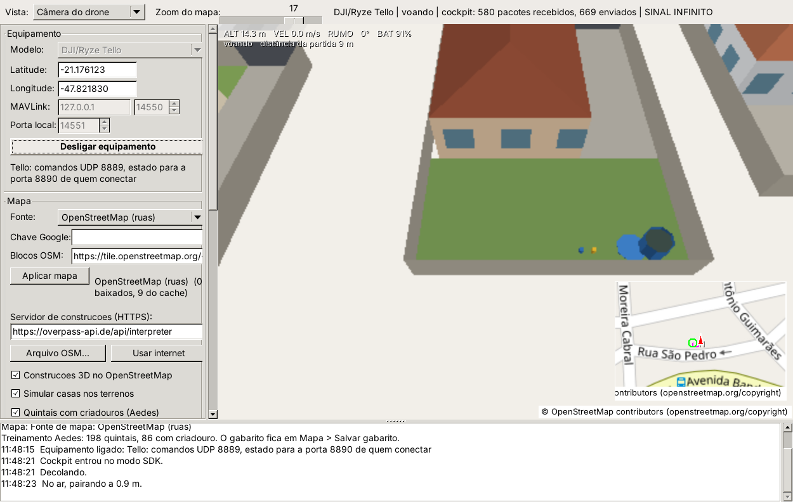
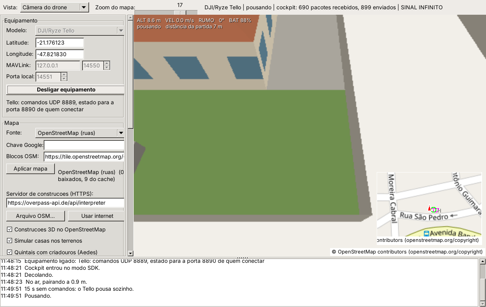
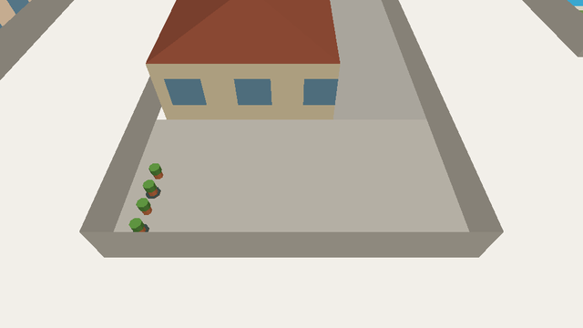
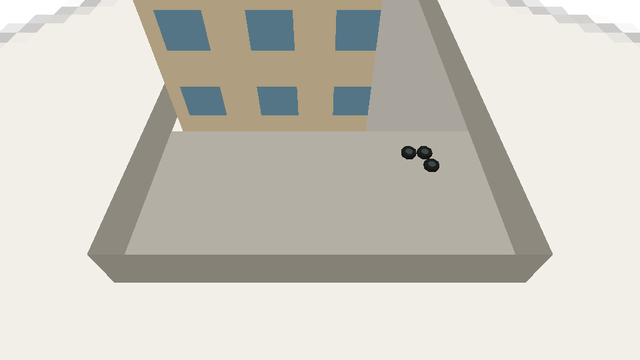
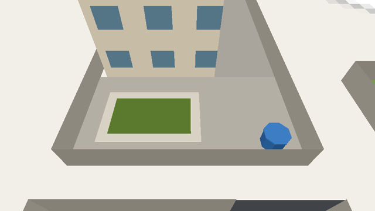
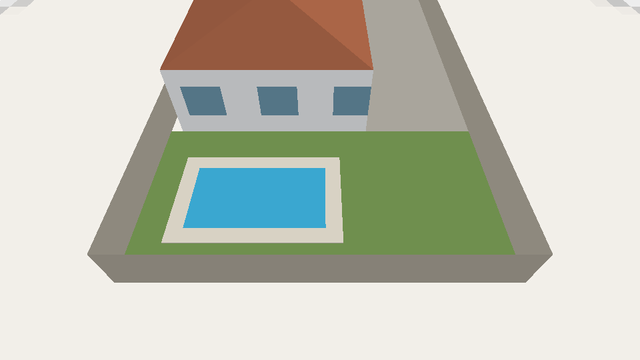

# Simulador — treinamento de inspeção de quintais (Aedes aegypti)

O simulador gera bairros de casas com **lote, muro e quintal**. Parte dos quintais tem **recipientes com água parada** que podem servir de criadouro do mosquito; os demais têm os **mesmos objetos em situação segura**. O exercício é sobrevoar o bairro e identificar quais casas precisam de visita.

> Este é um recurso de **treinamento**. Os quintais são fictícios e escolhidos pelo programa; não representam os imóveis reais do mapa. Uma imagem aérea **não confirma** larvas nem foco: a confirmação é sempre da equipe em campo.

**Disponibilidade:** recurso do código-fonte publicado em 09/11/2026. O `simulador.exe` e o instalador 0.46 do repositório ainda são anteriores; é preciso **recompilar o simulador** (Lazarus, `simulador/src/simulador.lpi`) para usá-lo.

*Vista em terceira pessoa a 25 m de altura: casas térreas com telhado de quatro águas, lotes murados ao longo das ruas e fileiras de casas ao fundo. Captura de tela do simulador compilado a partir deste código.*

## O que aparece nos quintais

| Objeto | Situação de risco (criadouro) | Situação segura |
| --- | --- | --- |
| Vasos de planta | vaso com **prato com água** (anel escuro em volta) | vaso sem prato |
| Piscina | **água verde**, sem tratamento | água azul, tratada |
| Caixa d'água (1000 L) | **destampada**, água escura visível, tampa largada no chão | tampada |
| Pneus | **sempre** risco quando expostos (acumulam água) | — |
| Tanque de peixes | **abandonado**: água verde, sem peixes | com peixes (pontos laranja) |
| Baldes | **destampados** com água | emborcados (virados para baixo) |

Os objetos têm medidas reais: vaso de 0,35 m, pneu de 0,6 m, caixa d'água de 1,4 m de diâmetro, piscina residencial de 5 × 2,8 m. Por isso é preciso **voar baixo** (10 a 20 m) para enxergar vasos, baldes e pneus — como na inspeção real.

*Câmera de inspeção a 14 m: caixa d'água destampada (água escura dentro, tampa azul no chão) e dois baldes emborcados. Captura de tela do simulador.*

*Lote vizinho: tanque de peixes abandonado, com água verde. Captura de tela do simulador.*

Vistas de referência dos demais objetos, geradas pelo mesmo código de desenho no teste automático `tests/test_criadouros.pas`:

| | |
| --- | --- |
|  *Vasos junto ao muro; os com prato acumulam água.* |  *Pneus expostos no quintal de um sobrado.* |
|  *Piscina sem tratamento (água verde).* |  *Piscina tratada (azul): não é criadouro.* |

## Como preparar o exercício

1. No simulador, em **Mapa**, escolha **OpenStreetMap (ruas)** e deixe marcadas **Construções 3D no OpenStreetMap**, **Simular casas nos terrenos** e **Quintais com criadouros (Aedes)**. Clique **Aplicar mapa**.
2. Em **Simulação**, marque **Câmera de inspeção (60 graus para baixo)**. Ela inclina a câmera do drone para olhar quintais e telhados e vale também para a imagem enviada ao cockpit. Para treinar sem perder o rádio, marque também **Sinal infinito**.
3. Aguarde o carregamento: o registro mostra, por exemplo, *"Treinamento Aedes: 198 quintais, 86 com criadouro"*, e o painel do mapa repete a contagem.
4. Ligue o equipamento e conecte o cockpit como de costume ([controles 0.46](../../docs/CONTROLES_0.46.md)).

O aluno deve sobrevoar o bairro e anotar as casas com risco e o tipo de recipiente encontrado.

## Gabarito do instrutor

Em **Mapa → Salvar gabarito dos quintais...** o simulador grava um arquivo CSV (abre em planilha) com uma linha por quintal:

| Coluna | Conteúdo |
| --- | --- |
| `lote` | identificador fixo do lote |
| `latitude`, `longitude` | centro do lote |
| `situacao` | `COM CRIADOURO` ou `sem criadouro` |
| `itens_com_agua_parada` | quantidade de recipientes de risco |
| `quintal` | descrição, por exemplo *"caixa d'agua destampada, balde emborcado (varios)"* |

O sorteio dos quintais é **fixo para cada lugar**: a mesma região gera sempre os mesmos quintais, em qualquer computador. Assim todos os alunos de uma turma fazem o mesmo exercício e o instrutor corrige pelo mesmo gabarito. No bairro de teste (ponto padrão, -21,1767; -47,8208, com o mapa em cache) são 198 quintais, 86 com criadouro, somando 207 recipientes de risco.

## Proporções das construções

Esta atualização também corrigiu as proporções do cenário:

- **Casas** simuladas: 8 × 9,5 m, pé-direito de ~3 m (térreas) ou ~6 m (sobrados, cerca de 12%), com telhado de quatro águas. Antes eram caixas de 5 a 7 m de altura com telhado plano e duas fileiras de janelas, que pareciam sobrados.
- **Lotes**: 13 × 20 m, muro de 1,8 m com portão, recuo frontal de 3,5 m, garagem lateral e quintal nos fundos, encostados ao longo da rua.
- **Prédios**: antes, cerca de 1 em cada 4 casas simuladas virava um prédio de 15 a 24 m. Agora prédios simulados só aparecem em áreas marcadas como apartamentos no mapa ou em cerca de 1 a cada 13 lotes (4 a 6 andares), e nunca no modo sem internet, que lê o mapa em cache.
- **Construções do mapa sem altura informada**: antes, toda construção com mais de 200 m² virava prédio de 15 m. Agora até 260 m² é casa térrea; até 1500 m², comércio/galpão de 6 m; acima disso, galpão de 8 m. Construções com altura ou andares no mapa continuam usando esses dados.

## Limitações

- Não há colisão física com casas, muros ou objetos.
- Objetos junto ao muro ou atrás da casa podem ficar escondidos numa vista inclinada; sobrevoe o lote.
- Os quintais são gerados nas casas simuladas. Construções reais do mapa não recebem quintal.
- O sorteio é fixo por lugar; ao mudar de bairro, mudam os quintais e o gabarito.
- O `simulador.exe` 0.46 do repositório não tem este recurso até ser recompilado. As capturas desta página foram feitas com o simulador compilado a partir deste código no Linux; os testes automáticos (`tools/test_simulator.ps1`) incluem `test_criadouros`.
